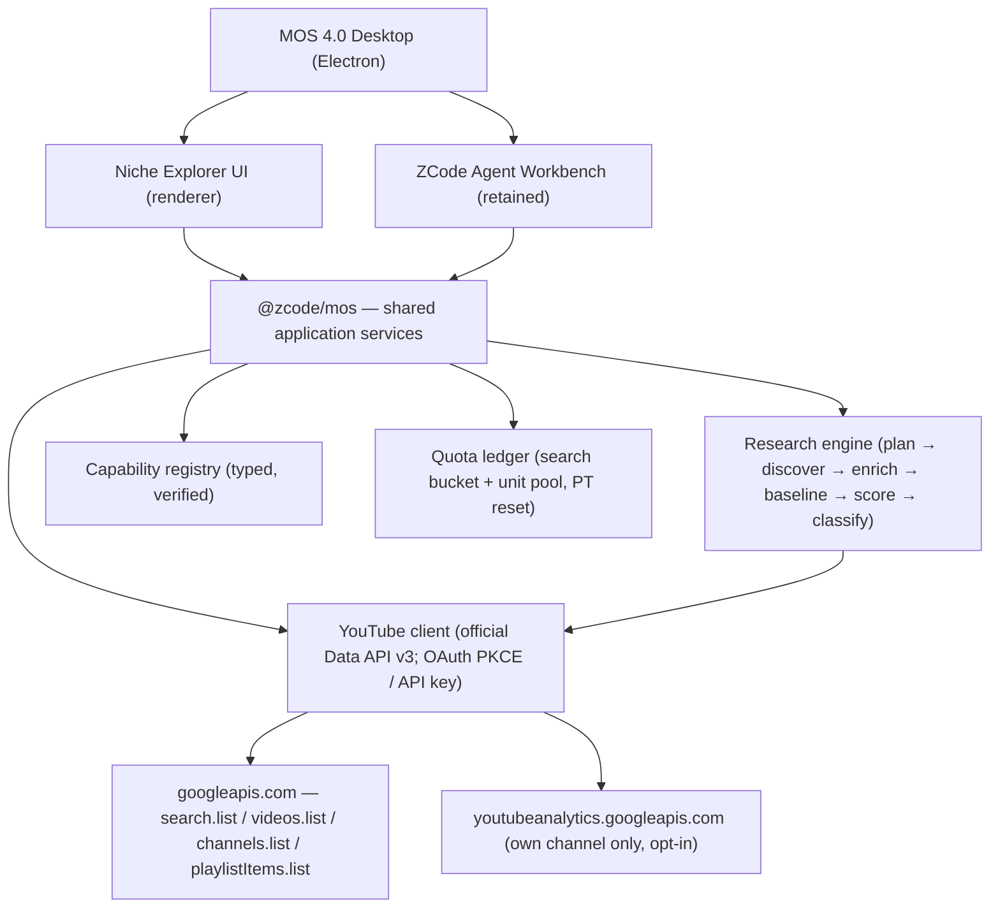

# MOS 4.0 system architecture

## Overview

MOS 4.0 = ZCode (application + agent foundation) + a YouTube Content Intelligence
layer. The MOS layer is a single new workspace package, `packages/mos`, consumed by
both the desktop UI and the agent's tools — one research engine, never two.

## Layers and boundaries

| Layer | Location | Rule |
|---|---|---|
| MOS core (pure logic) | `packages/mos/src/{capability,quota,youtube,research}` | No Electron imports; everything injectable (`fetch`, clock, ledger); fully unit-tested |
| Desktop services | `packages/services/src/mos/*` (planned) | Owns persistence + connection lifecycle; wraps `@zcode/mos` |
| UI | Niche Explorer panel (planned) | Talks only to services; renders scores/quotas with explanations |
| Agent tools | MCP tools + `youtube-niche-research` skill (planned) | Same services as the UI; never receives credentials |

**Extension-point policy.** MOS prefers ZCode's sanctioned surfaces (services layer,
MCP tool registration, UI panels). The set of modified upstream files is deliberately
small and listed in ADR-0002/ADR-0003; everything else is new files under
`packages/mos/`, `docs/`, `.github/`, and `scripts/mos/`.

## Data flow of a niche scan

1. **Niche + approved themes** (`research/niche.ts`, `research/themes.ts`) —
   LLM-expanded or manual/derived fallback; always user-editable before execution.
2. **Plan** (`research/planner.ts`) — concrete `search.list` requests under the
   depth budget and the ledger's remaining search calls; estimated quota cost is
   shown before the run.
3. **Discovery** (`research/discovery.ts`) — multiple orderings per theme,
   dedup across requests, niche post-filters, per-request failure recording.
4. **Enrichment** (`research/enrichment.ts`) — bulk `videos.list` (≤50 ids/unit) +
   `channels.list`; format classification from duration + live flags.
5. **Channel sampling** (`research/sampling.ts`) — recent uploads via the channel's
   uploads playlist (cheap `playlistItems.list`), bulk sample statistics.
6. **Baselines** (`research/baseline.ts`) — median views of comparable uploads,
   same format group, candidate excluded, explicit "unavailable" when history is
   insufficient.
7. **Scoring** (`research/scoring.ts`) — deterministic, versioned, documented
   anchors; missing data never yields good-looking numbers (completeness floor).
8. **Classification** (`research/classification.ts`) — Breakout / Rising /
   Evergreen / New Entrant with per-label explanations; momentum only from
   repeated observations.
9. **Evidence** (`research/evidence.ts`) — provenance per API call, collection
   timestamps, TTL/staleness rules, momentum computation.

## Persistence (planned)

ZCode's `node:sqlite` (`DatabaseSync`) with the shared migration runner for local
scan records, observations, evidence, and quota history. Credentials go through
ZCode's keyring-backed encrypted credential store — refresh tokens never appear in
scan records, logs, or tool output. Server-backed sync (if ever needed) uses a
PostgreSQL-compatible design; the storage adapter stays replaceable.

## What is deliberately NOT here

No scraping, no third-party YouTube data providers, no multi-platform research, no
publishing/uploading/commenting features. See `docs/product/MVP-SPEC.md` §Scope.
